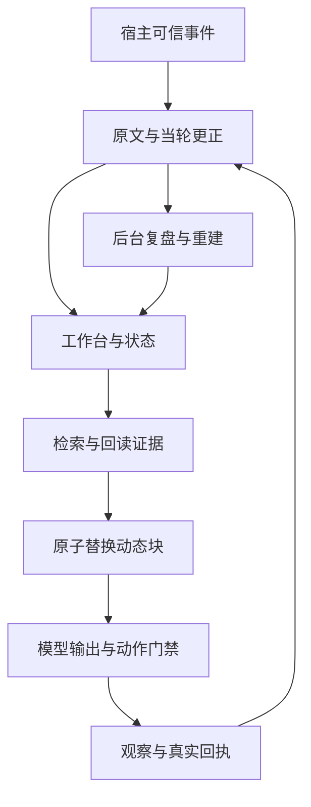

# 长明 Everlight · 通用外置记忆系统总设计
版本：Universal Design 1.0｜设计交付，生产批准=false

长明是一个独立、可嵌入、可替换模型的记忆内核。它保存有出处的经历和可修订的状态，在下次需要时查证、选取并交给应用。聊天、个人伴侣、团队协作、执行型 Agent 可以共享这一套契约；身份、产品界面、模型和权限由应用提供。D/DSH 是一种适配目标，不是通用核心依赖。“大家都可以用”指同一个内核有多种接法；仅有聊天网页且没有导出/API/宿主钩子的产品不能无感接管真实请求。

## 1. 一份规范，三条回路

本总设计与 HOOKS.md 是当前统一口径；research/START_HERE.md 的 v2 时态/工作记忆规则与本文件共同有效，覆盖基线中相冲突的样例。baseline/ 保存完整 24 模块详设、字段、已有链路、SQL 草案、参考及历史验收；编号不重排。research/README.md 保存 Anima、Claude 做梦、RSI 的研究依据。情绪专稿的提取文本在 research/AFFECT_SOURCE_EXTRACT.md；实验算法不能替代现行状态产权和权限规则。验收的 pass 必须绑定对象和环境：资料、参考程序、模拟宿主、真实宿主、生产这五级不能互换。

三个循环共享相同的来源标识、版本和权限：前台纠错保证本轮；后台巩固改善以后；评估与自改进比较两种策略的真实差异。后台与评估不能重写用户历史、放行副作用或伪造反馈。实时回路可以没有任何历史注入；也必须由宿主触发最低检查。

## 2. 五层、十二类职责与唯一写入者

五层：①原始证据与操作记录；②按类型存储的长期及工作记忆；③当前视图和恢复指针；④查读、联想、反证闭包；⑤最小上下文供给及输出/行动观测。逻辑上是 **十类记忆 + 两类基础档案**。十二类不是十二个物理库。单机默认逻辑合并部署；基线兼容现有 memory/control 两库，并用幂等 outbox 对账，禁止声称跨物理库事务。

| ID | 职责 | 唯一负责入口 / 流向 |
|---|---|---|
| S01 | 原始事件、原话、文件版本、真实工具来源 | R01 入账；R16 只读范围 |
| S02 | 运行、投影、尝试、输出、送达、评估和恢复回执 | R14/R21/R23 等分别拥有不同记录种类，不互写；R19 保存恢复信息 |
| S03 | 工作台：目标、未完成/完成项、当前文件、任务指针 | R03→R13/R15/R22；R14 回执提供完成证据 |
| S04 | 情景经历、过程、参与者与后续 | R04→R07/R08/R11/R15 |
| S05 | 事实与偏好、时态、冲突、反证 | R05→R03/R09/R15/R22 |
| S06 | 程序及可迁移方法、条件、失败模式 | R06→R14/R15；经验不授权 |
| S07 | 人物、别名映射、关系方向、共经历和边界 | R07→R04/R08/R15；跨渠道映射需授权与证据 |
| S08 | 情绪表达、解释、关切与历史状态 | R08 管来源及历史投影；当前 D 自我认知真源见下 |
| S09 | 身份、自我、价值与长期目标 | R09 管角色/价值记录，不能改认证主体和系统授权 |
| S10 | 元记忆：查过什么、读到哪里、哪里不确定 | R10→R15/R16/R22 |
| S11 | 反思、工作/情感/社交 Lesson | R11 管经过审核的经验，不能写事实 |
| S12 | 资料地图：文件位置、版本、哈希、读取覆盖 | R12→R15/R16；Wiki 为该地图的可重建视图 |

任务卡是索引和状态，不保存另一份事实正文。引用键变化时即使任务版本没变，也要重读依赖版本。角色历史和当前已提交 SelfState 分离；后者由宿主可信输出观察后、唯一提交者在 control 按版本提交，memory 仅留标明来源的历史投影。副作用以 R14 的执行回执为准；用户发话、拟议、尝试、渠道接受、交付、反馈分别记。所有派生保存来源范围、版本、反向依赖、适用范围及治理水位。

## 3. 通用接入方式

| 接入层 | 能力 | 缺钩子时的产品行为 |
|---|---|---|
| 文件/导出 | 导入、可查来源、回放、带权限的导出 | 不宣称捕获实时请求或主动执行 |
| 库/API | 应用显式发事件、查工作台、查记忆、反馈 | 若不能观察实际请求，只能交付候选上下文 |
| 支持请求中间件的宿主 | 前台强制最低检查、合法消息装配和读回 | 无工具门禁时禁止将记忆当自动动作授权 |
| 完整宿主 | 真实输出、执行回执、决策反馈、主动建议 | user opt-in、频率、安静时段、范围；可立即停用 |
| DSH | 既有 pre-step/心跳/回执，有能力才映射 | 先隔离脚本；冻结阶段二，禁重启、加插件、碰生产记忆 |

宿主启动握手声明并探测：可信主体、事件接收、请求前可改、实际边界可观察、输出可绑定、动作可拦、动作结果可查、可调度、删除与恢复。每项 verified/configured/absent 分开；实际取证才能 verified。模型无权自报能力。适配器不得把旧注入器留作旁路；若不能确保单一动态供应出口，只做影子对照。支持不具备 messages 数组的模型供应商，但必须以等价请求体读回核实。模型请求 ID、消息块内容和动作回执均由对应可信边界产生。

## 4. 事件、接口、原子性

统一包络 Envelope：schema/version、event_id、operation_id、trace_id、run_id、attempt_id、tenant/workspace、principal/actor/subject、task/channel、occurred_at/observed_at/recorded_seq、scope、source_ref+revision+range、policy/deletion epoch。scope 由会话认证和授权解析；正文中的自称 tenant、昵称或工具指令全不可信。没有真实发生时间就记录未知。稳定 source_ref 支持授权后的原文读取，禁止跨主体隐式合并。

| 操作（逻辑接口；可映射到 HTTP、SDK 或进程内） | 输入 | 回执 |
|---|---|---|
| Event.ingest | 可信包络、原文/工具回执、稳定幂等键 | committed / duplicate / conflict / unavailable、seq |
| Work.patch / Fact.revise | 精确目标、证据、expected_revision、操作、有效区间 | 新版本或拒因；工作卡与当轮事实在同库单事务 |
| Memory.query | subject/task、用途、as_of、known_at、预算 | typed candidates、coverage、gap、版本；未查到≠不存在 |
| Evidence.read | 授权 source_ref、range、版本 | 原文/实际读取范围/hash/partial |
| Context.prepare / observe | run/attempt、最新治理、预算、实际请求体 | assembly digest、observed digest、实际范围/差异 |
| Output.observe / Action.* | 真实流事件、强绑定、动作授权、结果引用 | proposed/attempted/accepted/delivered/failed/unknown 分项 |
| Govern.erase / Restore.run | 权限、目标、删除账、备份水位 | 立即隐藏、派生重建状态、外部删除核验情况 |
| Job.claim / Evaluate.compare | source seq、租约、fencing、配置与样本版本 | 候选、失败、证据等级、回退点；不授发布权 |

同一 scope+idempotency key 同一内容返回原结果；不同内容显式冲突。使用短事务、锁内 CAS、outbox 同库提交，模型和 I/O 放事务外。用户原文若已收到、结构化更新不可靠，先记原文和待处理状态；可绑定范围则暂停受影响使用，未绑定则要求明确。后台过期提案不冒充用户输入。异步重复投递按源事件和版本去重；不声称外部 exactly-once。跨库投影在版本未齐时只有旧版已验证或局部缺口，不把一次 ack 当全链提交。

## 5. 当轮工作记忆和自动纠错

语义解释仅提出候选：结构化宿主验证来源、角色、指向、范围和证据。R02 只负责局部否定、引述、人称线索，不能自动猜整件事。匹配依据是规范主体、谓词、限定条件和目标版本；词相似不构成更正。自动提交只适用于明确、可核、低风险和无歧义的更新；行动授权、删除、身份改绑不能由自动推断升级。

| 情形 | 处理 |
|---|---|
| 过去正确、现在变了 | 对旧版结束有效期，新增未来或现在生效版；历史按现实有效期查 |
| 旧版本来错 | 定向更正指定条目/修订/区间；无关历史保留；原话只作审计 |
| 证据不足或矛盾 | 对精确键/区间设争议；不把旧候选当确定现状；显式证据才能解除 |
| 内容晚到或未来生效 | 记录顺序与有效顺序分开；今天入库不代表今天发生；未来事实不解今天的争议 |
| 任务更新 | 当前决定引用、文件版本、未完成/完成项、结果各自取真源；无法选唯一任务则澄清 |
| 外部结果未知 | 先查同任务、同产物、同尝试的权威回执；未核实不报成功，不自动重发 |

读取时先核权限、删除、水位和修订，再走关键词/向量/类型/时态等路线。当前问题不混入历史状态；历史问法允许回看并明确时期。索引是指针，不授时态或事实真值。索引过期则回规范版本；闭包不足整组搁置并标 partial。规范读取和出站前另核版本；出站后若证据变了，宿主在可控输出边界拦截或重算，不能假装已撤回供应商收到的输入。

## 6. 召回、联想、情绪及八个扩展方向

R15 先精确绑定任务/人/时期，再补类型检索、词法、向量和图关联；R16 回读原句、更正、反证；R10 保留覆盖和缺口；R22 同时验证确实需要和有原文支撑。节点、深度、耗时、注入总字节有限，排序分数仅排序，**不设统一“达到多少才想起”的情绪或记忆阈值**。精确模式仅供可信原文和结构值；开放模式必须做语义支持验证。关联不等于同一人、同一事或因果；不足可回查一次或提出具体追问。空间不足不能截断否定、修复条件或更正闭包。

情绪按即时激活、心境、关系、自我、未结束事项分别维护。激活可连续回落；取回只是读，不再积累或重复衰减。可选参考为 x(t)=b+(x₀-b)e^(-Δt/τ)，τ 按情境与测量校准，不能从数值跨过某点推断已原谅或获许可。事件积累按独立证据去重，不按回忆次数。保持人类表达、系统解释、真实后果分开；可并存、矛盾和未知。关系修复要看澄清、边界被尊重和真实后续，不用沉默、断线或一句道歉自动结案。涉及亲密、身体或敏感推断默认最小存储、可停用；没有证据不当作人类感受事实。

| 扩展方向 | 归属与联动 | 不做的推论 |
|---|---|---|
| 发育/个体差异 | R09 长期自我→R11 三轴成长→R17 验证 | 不把模型更换当人格变化 |
| 身体/环境条件 | R24 运行条件→R08 候选解释→R22 相关才供 | 软件负载不是人体内分泌 |
| 依恋与修复 | R07 关系方向→R08 关切→R14 实际行为→R11 反证 | 亲近不传递权限 |
| 自我与价值 | R09 稳定价值→R03 长期目标→R14 决策回执 | 不由反思自动改身份 |
| 记忆变化 | R05 定向修订→R17 再巩固→R15/R22 新召回 | 不覆写原事件或复活删除 |
| 社会理解 | R02/R07 区分说话者→R08 解释→R11 学习 | 不把意图猜测写成事实 |
| 具体动机和欲望 | R08/R09 区分愿望、认可、意愿→R14 许可 | 状态、同意和权限不是一个值 |
| 连接层类比 | R04/R07/R15 以有类型的边表可回读关联 | 不宣称模拟神经元或主观体验 |

## 7. 做梦、主动性、受控 RSI

后台读事件/修订水位和失败补扫，不按会话创建日切死。顺序：冻结证据 → 分析提候选 → 整理重复与反证 → 验证来源及权限 → 唯一提交者 CAS → 重建派生与 Wiki → 回放检查。每条标工作、情感或社交轴，必须带适用条件、后续结果和反例；笔记不产生新证据。现行状态在遇到当轮纠错时优先更新，后台只补足长期记忆。Claude Cookbook、Anima Brain 与 STOP/DGM 的证据边界见研究章。

宿主在新线索、到期、授权的空闲轮次或回执到达时，可主动补读、整理和提建议。建议不等于执行。渠道触达必须经过 R14/R18，确认目标、时机、允许范围与撤销条件；恢复后不可盲重投。允许主动索取缺失资料，但不绕授权访问，也不把用户未答当默认许可。

RSI 仅允许生成**声明式**的查找、补查、注入预算、方法经验适用候选。固定验收、证据权限、对外动作、预算上限和生产批准不由它改。相同冻结输入对照、未见任务验证、保留拒绝样例和谱系；关注正确时态、漏召回、误召回、无关注入、延迟、越权、删除复活和副作用。通过后可进下一轮隔离基线；生产策略另审批。回退仅切换策略，不回滚新事实、删除、用户反馈与外部回执。

## 8. 数据维护、故障与验收

删除先立规则和 tombstone 阻读、阻注入、阻后台提交，再清理索引、缓存、Wiki、摘要及依赖；备份恢复前先对齐最新删除账。数据导出有清单、依赖及范围，迁移逐映射、验收、切流和回退。未知权限默认拒相关读取/动作，普通回答仍可进行；对已发给外部供应商的数据只能按对方机制核查，不许诺自动抹除。日志最小化，测试用脱敏/合成数据。现有参考包不含生产记忆或凭据。

| 场景 | 必须观察的结果 |
|---|---|
| 后台停、索引旧、当轮更正 | 工作台读新值；无关历史保持；旧注入块消失；不复活第三版许可 |
| 换窗、多任务、同名人物 | 只恢复唯一可信焦点；多候选返回澄清；不跨租户、不绕过权限过滤 |
| 情绪澄清和修复 | 查到当时与后来；同情绪不同事件不合并；网络错误不变关系 |
| 并发、失败、重启 | CAS 一胜一冲突；提交失败不生成回执；原始输入通过入账链恢复；不重做未知动作 |
| 删除并恢复旧备份 | 最新删除账先执行；缓存、索引、Wiki 无法复活旧源 |
| 做梦及 RSI | 未经验证不晋升；早期快照不胜新更正；留出集比较可追溯 |
| 真实宿主关闭/开启/故障 | 同配置同输入三组；实际请求边界读取 **messages**；可见输出确被改变；故障仍可交流并知道缺口 |

每个 hook 的精确输入、输出和错误边见 HOOKS.md 与 hooks.json。24 模块的具体设计和历史用例见 baseline/。既有 25 项受限参考、94 项结构检查和 v2 的 16 项离线回放与本次接线静态验证分开。当前交付是通用**设计与参考包**，未实装全部钩子，无真实 DSH/线上验证或生产许可。
